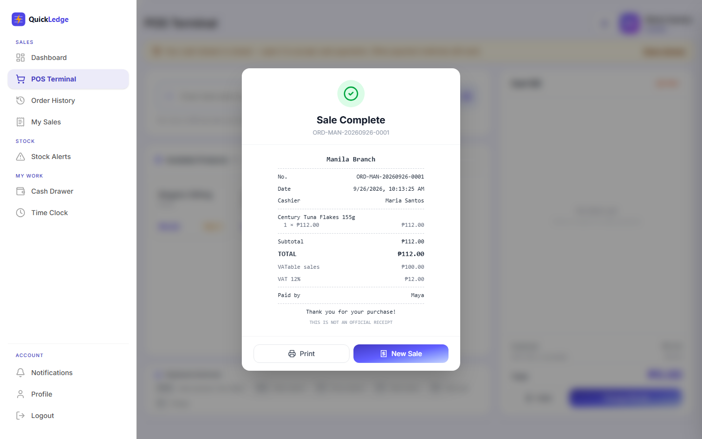
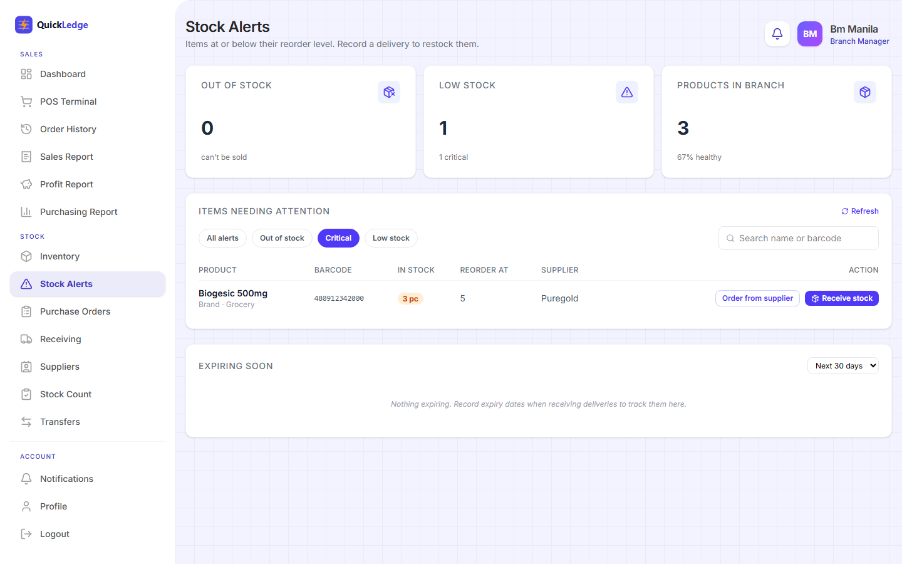
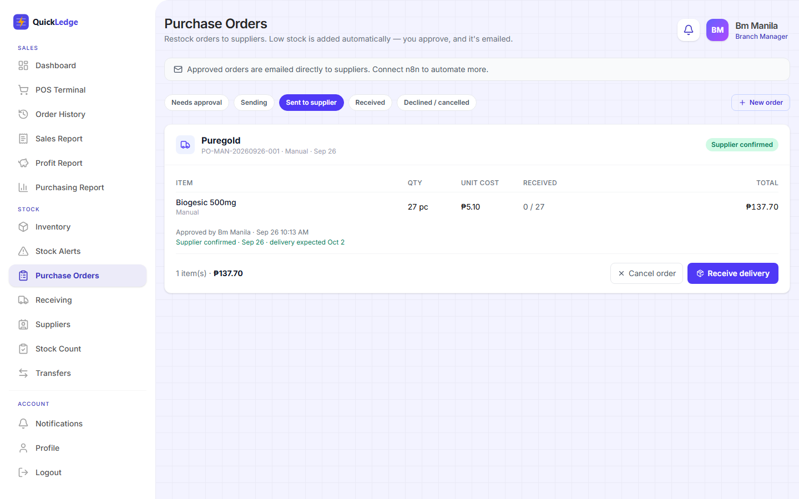
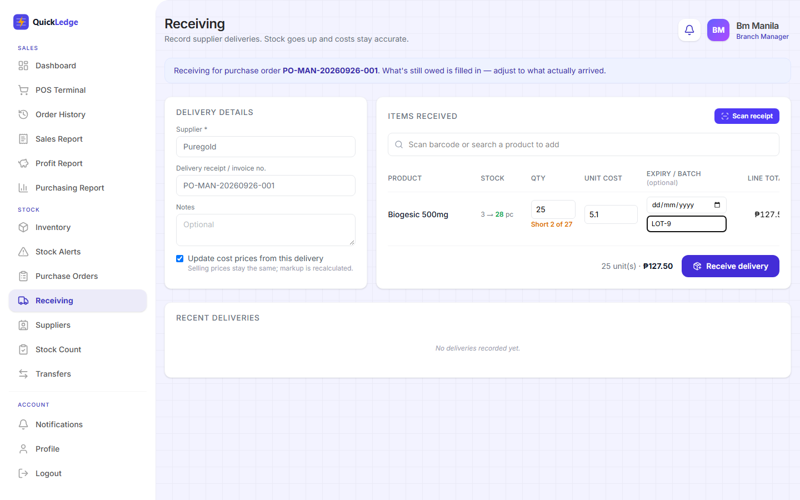
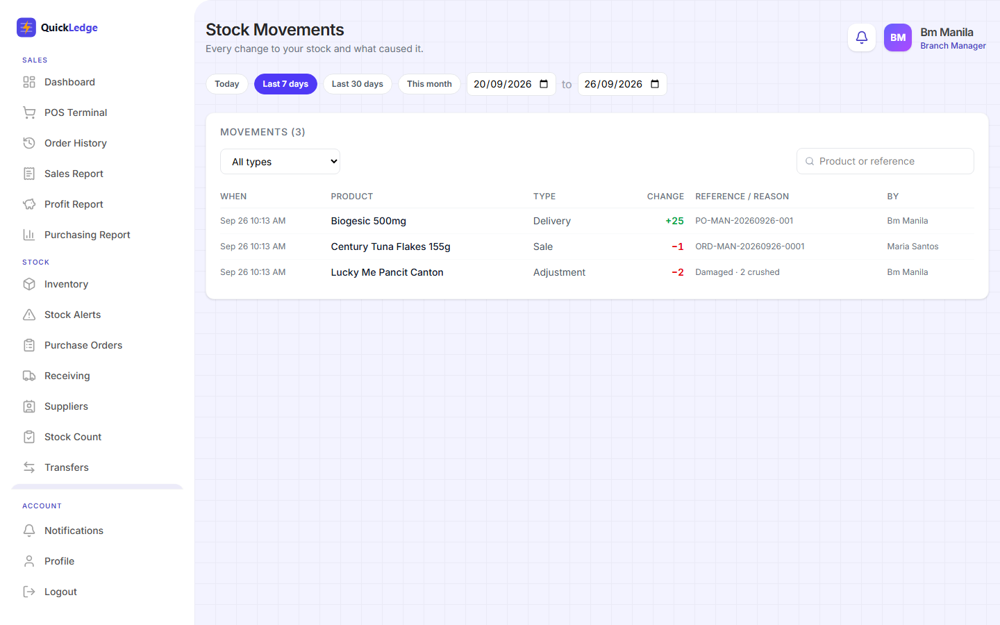
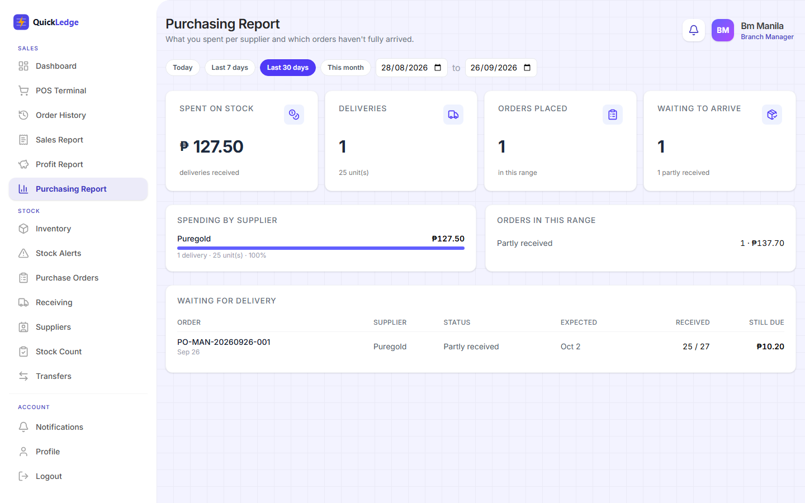

<p align="center">
  
</p>

<p align="center"><b>Quick sales. Clean ledger.</b><br/>
A point-of-sale and inventory system built for Filipino sari-sari stores and small groceries.</p>

<p align="center">
  React 19 · Vite · Tailwind 4 · TanStack Query &nbsp;|&nbsp; Express 5 · MongoDB (Mongoose 9) · JWT
</p>

---

QuickLedge runs the whole day of a small store with several branches. The cashier opens the drawer, rings up sales by barcode, gives the right change and prints a thermal receipt. The manager receives deliveries, handles refunds with a PIN and counts stock. The owner closes the day with a Z-reading that balances to the centavo.

It is built around how Filipino stores actually work:

- **Tingi selling.** Items are sold by the piece, sachet or kilo.
- **Senior and PWD discounts.** Applied the legal way: VAT-exempt, then 20% off, with the OSCA/PWD ID and a manager's PIN.
- **Cash-first.** Any payment method is optional and can be turned on in settings.

> This repository is the **web app**. The API lives in [Housechores-Backend](https://github.com/Adrianne99/Housechores-Backend).

## Screenshots

| Checkout receipt | Stock alerts (critical items) |
|---|---|
|  |  |
| **Purchase order: supplier confirmed** | **Receiving: short delivery** |
|  |  |
| **Stock movements** | **Purchasing report** |
|  |  |

## Features

**Cashier**
- Fast POS with barcode scanning (USB scanner or phone camera), category filters and held carts ("babalikan").
- Cash drawer: opening float counted by denomination, cash in/out with reasons, and a Z-reading at close.
- Senior citizen / PWD discounts and larger discounts need a manager's PIN on the spot. Every approval is logged.
- Refunds of single items with a manager's PIN. Damaged items are refunded without going back on the shelf.
- Offline mode: sales made while the internet is down are saved on the device and synced later, and are never recorded twice.
- 58 mm / 80 mm thermal receipts, plus time clock and own sales summary.

**Branch manager**
- Inventory with reorder, critical and "order up to" levels, supplier SKU and live stock alerts.
- Receiving: record deliveries against a purchase order, with batch numbers, expiry dates and automatic shortage tracking.
- **Receipt photo scanning:** photograph a supplier's receipt, and in-browser OCR (Tesseract) matches the lines to products. When a cost goes up, the app suggests a new selling price.
- Purchase orders: low stock is drafted automatically per supplier. You approve and email it, then record the supplier's confirmation.
- Stock adjustments with required reasons (damaged, expired, lost…), end-of-day stock counts, and transfers between branches (sent → received).
- Voids, shift schedule, attendance, and expiring-stock list.

**Owner (admin)**
- Dashboard across branches, plus sales, profit (at cost when sold) and purchasing reports.
- Stock movements: every change to stock with its cause (sale, void, refund, delivery, adjustment, transfer).
- Activity log of sensitive actions (price changes, voids, refunds, drawer variances…).
- Store settings: receipt details, VAT registration, payment methods, cash-variance alert limit, branches.

**Automation (optional)**
- Signed webhooks to [n8n](https://n8n.io) (HMAC-SHA256 plus an event ID) for low stock, refunds, deliveries and cash variances.
- An API-key protected API so n8n can read reorder candidates (with recommended quantities), create purchase orders and record supplier replies.

## How it's built

```
Browser (React SPA) ──/api──▶ Cloudflare Pages Function ──▶ Express API ──▶ MongoDB Atlas
        │                         (same-site proxy:                │
        └─ offline sales queue      first-party login cookie)      └─▶ n8n (signed events)
           (localStorage)
```

- **Multi-branch, multi-tenant.** Every record belongs to an organization, and managers and cashiers only ever see their own branch.
- **Money and stock are transactional.** Sales, refunds, voids, deliveries and transfers run in MongoDB transactions. Stock is decremented with conditional updates, so two cashiers selling the last unit can't both succeed.
- **Idempotent sales.** Each sale carries a client reference, so a retried or offline-synced sale is stored once.
- **Server-side pricing.** Totals, VAT and discounts are computed on the server. The client-side copy of the pricing rules is kept identical by a parity test.
- **Data fetching.** TanStack Query handles caching and targeted invalidation. Dialogs mount only while open, so there are no `useEffect` refetch chains.

## Testing

| Layer | What | Result |
|---|---|---|
| API | 164 integration tests (node:test + supertest, in-memory MongoDB replica set) | all passing |
| Browser | Playwright end-to-end flows for all three roles, including phone width (50 checks) | all passing |
| Store day | 101 scripted situations run against the live database: voids, refunds, discounts, holds, drawer cash in/out, transfers, short deliveries, closing | 101 / 101 |
| Simulation | A 93-minute store day on MongoDB Atlas (see below) | every peso and unit reconciled |

### Store simulation

1 owner, 3 branches (a manager each) and 8 cashiers traded for 93 minutes, cash only. There were 75 minutes of normal trading, then a 15-minute rush with all cashiers ringing non-stop, then closing with Z-readings. After closing, a script compared everything the server reported with an independent record of every successful action.

| | |
|---|---|
| Sales | **3,714** completed (21 voided), avg ₱87.77 |
| Net after 52 refunds | **₱324,915.59**, identical on server and independent ledger |
| Senior / PWD discounts | 138, each approved with a manager's PIN |
| Deliveries / write-offs | 174 deliveries (13,808 units) / 49 damaged items |
| Rush hour | ~196 sales per minute, peak 215 |
| Stock | 129 of 129 items exact; never negative; 34 oversell attempts correctly refused |
| Cash | 8 of 8 drawers matched expected cash to the centavo; a ₱120 shortage alerted the branch manager |
| Server errors | 0 |
| Checkout latency (PH → Atlas) | p50 443 ms, p95 945 ms |

The simulation also found two real issues, both now fixed and covered by tests:
- The same sale sent twice at the same moment (a Wi-Fi retry) could report "insufficient stock" on the second copy instead of returning the recorded sale.
- Repeated low-stock alerts buried cashiers' restock requests.

## Run it locally

Requirements: Node 20+, and the [backend](https://github.com/Adrianne99/Housechores-Backend) running on port 4000.

```bash
npm install
npm run dev        # http://localhost:5173  (proxies /api to localhost:4000)
npm run lint
npm run build
```

## Deploy

- **Frontend:** Cloudflare Pages. Build `npm run build`, output `dist`. Set `BACKEND_URL` to the API address. `functions/api/[[path]].js` forwards `/api/*` to it, so the login cookie stays first-party (Safari/iOS block third-party cookies).
- **Backend:** any Node host (e.g. Render) with MongoDB Atlas. See the backend README.

## Notes

- Receipts print as acknowledgment receipts. Only BIR-accredited POS systems may issue official receipts in the Philippines.
- All amounts are in Philippine pesos (₱), and dates use Asia/Manila time.
